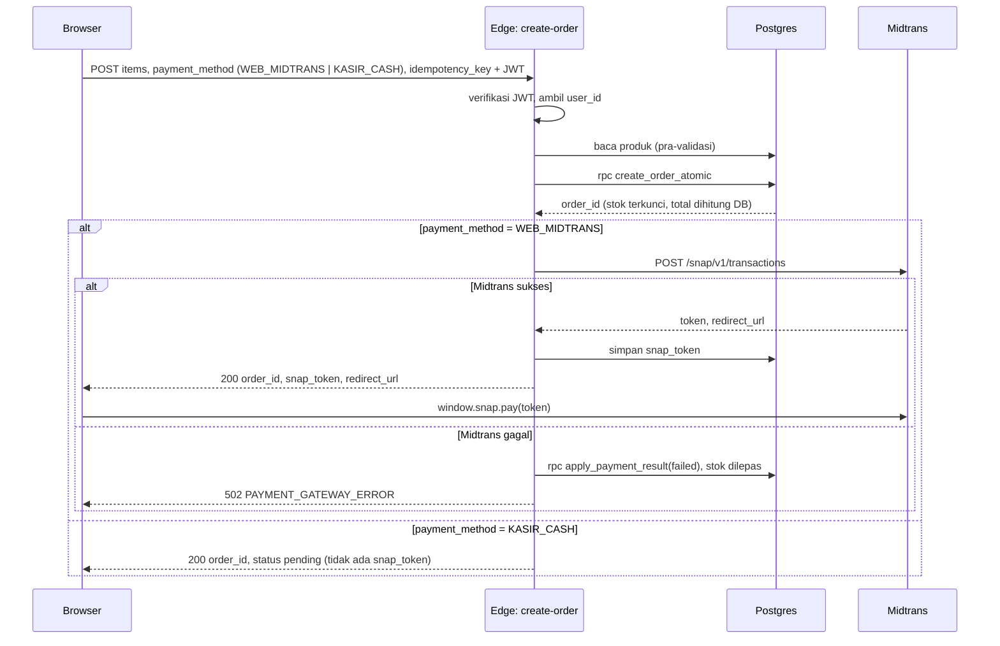
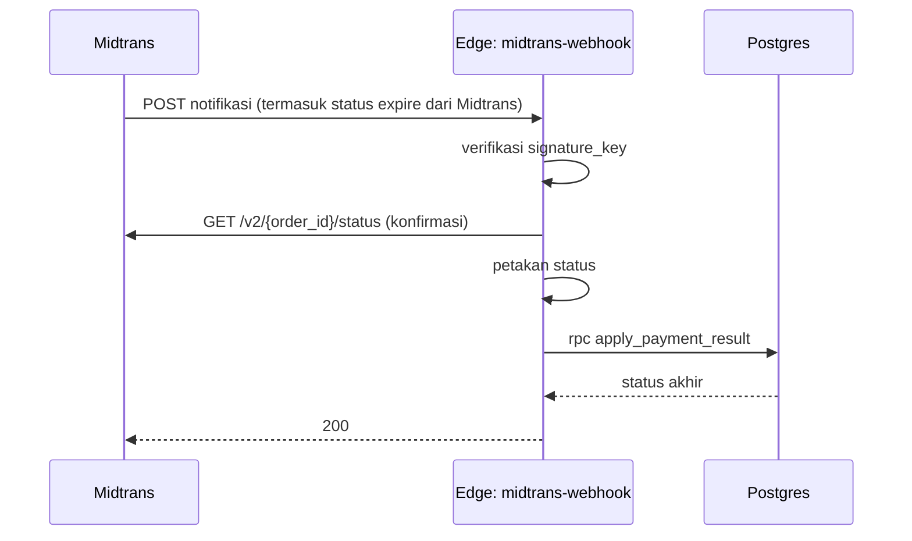
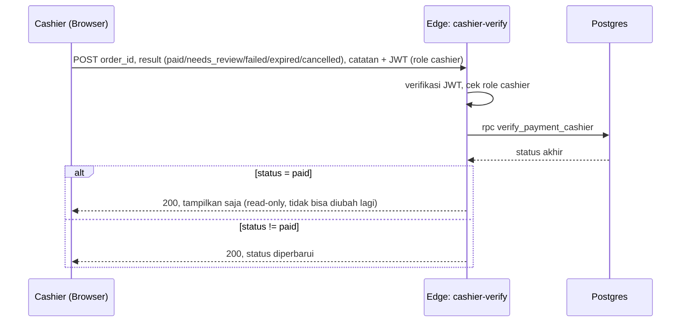
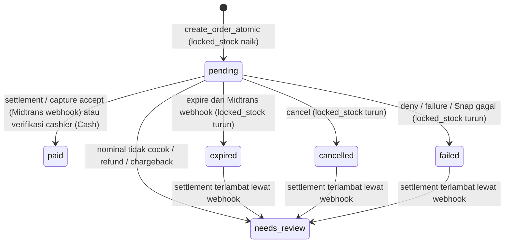
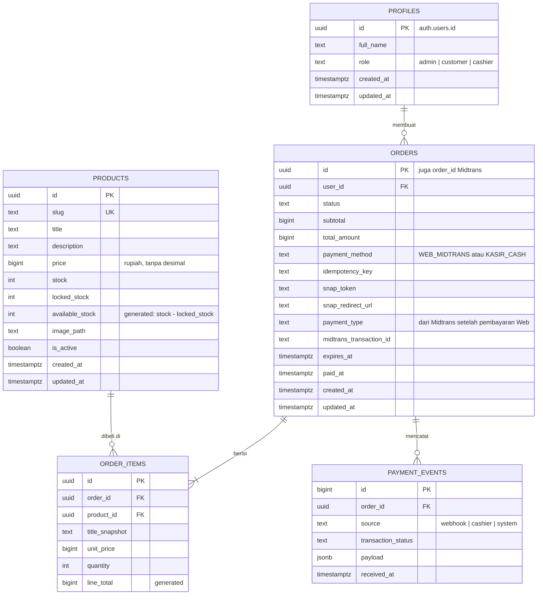

# Product Requirement Document v2

Proyek: Pemesanan Produk Digital Clean Architecture (React + Supabase + Midtrans Snap)
Status: Draft v2, menggantikan v1
Pemilik keputusan: Pasha Prabasakti

---

## 0. Ringkasan Perubahan dari v1

Dokumen ini menulis ulang v1. Struktur Clean Architecture dipertahankan. Yang berubah adalah jalur uang, jalur stok, keamanan, arahan UI, dan jenis produk (digital bukan fisik).

1. Validasi stok dan penguncian stok dipindah ke satu fungsi PostgreSQL atomik (`create_order_atomic`). Di v1, cek stok lalu update lewat dua panggilan HTTP terpisah, sehingga dua checkout bersamaan bisa sama-sama lolos dan stok jadi minus.
2. Ada siklus hidup stok lengkap: kunci saat order dibuat, potong saat dibayar, lepas saat gagal atau ditolak. Di v1, `locked_stock` hanya pernah naik dan stok tidak pernah turun.
3. Ada Edge Function `midtrans-webhook` dengan verifikasi signature. Di v1 tidak ada cara sah menandai order `paid`.
4. `user_id` diambil dari JWT, bukan dari body request. Di v1 siapa pun bisa membuat order atas nama user lain.
5. RLS `profiles` tidak lagi public. Cek admin memakai fungsi `is_admin()` (security definer) supaya policy tidak rekursif. User tidak bisa mengubah `role` miliknya sendiri. Ditambah role `cashier`.
6. Checkout memakai idempotency key dan batas order pending per user, supaya klik ganda tidak membuat dua order dan satu akun tidak bisa mengunci seluruh stok.
7. Skema ditambah kolom yang wajib untuk Midtrans dan audit: `expires_at`, `paid_at`, `payment_type`, `midtrans_transaction_id`, `payment_method`, tabel `payment_events`, `products.is_active`, `products.slug`. Alamat pengiriman dan ongkir dihapus (produk digital).
8. Checkout menawarkan dua pilihan pembayaran: **Bayar di Web (Midtrans)** dan **Bayar di Kasir (Cash)**.
9. Role `cashier` dapat memindai kode transaksi dan mengubah status pembayaran. Order yang sudah `paid` hanya ditampilkan (read-only).
10. Tidak ada `pg_cron`. Kedaluwarsa ditangani sepenuhnya oleh notifikasi webhook Midtrans (`expire` -> `expired`). Fungsi `expire_stale_orders` dan jadwal cron dihapus.
11. Struktur frontend dirapikan: store Zustand dan hook React pindah ke presentation, use case jadi TypeScript murni.
12. Arahan UI memakai `DESIGN.md` dan Delivery Gate antislop. "Rapi, modern, responsif" diganti keputusan yang bisa dicek.
13. Prompt eksekusi jadi 6 tahap, masing-masing punya kriteria selesai dan perintah verifikasi.

---

## 1. Ringkasan Produk

Tempat pemesanan produk digital satu penjual. Customer melihat katalog produk digital, memilih cara pembayaran di kasir (Bayar di Web lewat Midtrans atau Bayar di Kasir/Cash), lalu memantau status order. Admin mengelola produk, stok, gambar, dan melihat order masuk. Cashier memverifikasi pembayaran cash melalui pemindaian kode transaksi.

### 1.1 Dalam cakupan (MVP)

1. Katalog produk digital aktif dengan stok tersedia yang akurat.
2. Keranjang tersimpan di `localStorage`.
3. Checkout dengan pilihan pembayaran: Bayar di Web (Midtrans) atau Bayar di Kasir (Cash).
4. Pembayaran Midtrans Snap (sandbox lalu production) untuk opsi Bayar di Web.
5. Halaman riwayat order dan detail order, termasuk tombol lanjutkan pembayaran untuk order yang masih pending.
6. Admin: CRUD produk, upload gambar, ubah stok, nonaktifkan produk, daftar order, daftar order `needs_review`.
7. Cashier: scan/masukkan kode transaksi, verifikasi pembayaran cash, lihat order yang sudah dibayar (read-only).
8. Login dan registrasi email + password lewat Supabase Auth.

### 1.2 Di luar cakupan (MVP)

1. Alamat pengiriman dan ongkir (produk digital, tidak perlu pengiriman fisik).
2. Integrasi kurir dan ongkir dinamis (Tidak Perlu).
3. Pembayaran Midtrans diatur di dashboard Midtrans; frontend hanya menawarkan dua opsi atas (Web Midtrans atau Kasir Cash).
4. Refund otomatis, partial refund, chargeback. Status ini masuk `needs_review` dan ditangani manual di dashboard.
5. Pembatalan order oleh customer. Order pending selesai lewat kedaluwarsa dari notifikasi Midtrans.
6. Voucher, diskon, varian produk (ukuran, warna), multi-gudang.
7. Fulfilment dan resi pengiriman.

### 1.3 Keputusan terbuka (wajib diisi sebelum Tahap 1)

Nilai di kolom kanan adalah rekomendasi. Ganti kalau tidak sesuai.

1. Nama toko: Isade Store
2. Jenis produk: digital. Alamat dan ongkir sudah dihapus dari seluruh dokumen.
3. Masa berlaku pembayaran: Diatur oleh midtrans.
4. Maksimum order pending per user: 3.
5. Maksimum jenis produk per order: 20. Maksimum kuantitas per produk: 99.
6. Email admin pertama: pashaprabasakti@gmail.com
7. Email cashier pertama: isadecompany@gmail.com
8. Origin frontend production: [saat ini belum ada]
9. Isi `DESIGN.md` (lihat bagian 10). Tanpa ini, UI hanya boleh dirilis sebagai draft.

---

## 2. Tech Stack

1. Frontend: React 19, Vite, TypeScript (strict), Tailwind CSS v4 lewat `@tailwindcss/vite`, shadcn/ui, Zustand, React Router v7 (mode library).
2. Backend: Supabase (PostgreSQL, Auth, Storage, Edge Functions Deno).
3. Pembayaran: Midtrans Snap.
4. Testing: Vitest (frontend), `deno test` (Edge Functions), SQL test script untuk RPC.
5. Tipe database: `supabase gen types typescript`, bukan ditulis manual.

Alasan pilihan yang tidak jelas dengan sendirinya:

1. Zustand untuk keranjang: state kecil, butuh persist ke `localStorage`, tidak butuh provider. Context API akan memicu re-render seluruh pohon.
2. Logika stok di PostgreSQL, bukan di Edge Function: hanya database yang bisa menjamin cek dan update terjadi dalam satu transaksi dengan row lock.
3. Tidak ada `pg_cron`: kedaluwarsa ditangani sepenuhnya oleh webhook Midtrans, tidak ada pengecekan kadaluwasa di sisi backend.
4. Tipe hasil generate: skema berubah, tipe manual akan tertinggal tanpa ada yang sadar.

---

## 3. Arsitektur

### 3.1 Prinsip layer

Dependensi hanya boleh mengarah ke dalam: presentation ke application ke domain. Data layer mengimplementasikan interface dari domain dan disambungkan di satu composition root.

Aturan yang tidak boleh dilanggar:

1. Harga, total, dan stok yang sah hanya dihitung di database. Client dan Edge Function tidak pernah mengirim harga ke database.
2. Status `paid` hanya boleh ditulis oleh fungsi `apply_payment_result` (dari webhook Midtrans yang valid) atau `verify_payment_cashier` (dari role cashier untuk opsi Cash).
3. Fungsi RPC yang mengubah stok hanya bisa dieksekusi `service_role`.
4. Tidak ada fungsi atau jadwal yang mengecek kadaluwasa order di sisi database. Kedaluwarsa hanya datang dari notifikasi `expire` milik Midtrans.

### 3.2 Struktur direktori

```text
root/
├── CHANGELOG.md
├── DESIGN.md
├── supabase/
│   ├── config.toml
│   ├── seed.sql
│   ├── migrations/
│   │   ├── <timestamp>_profiles.sql
│   │   ├── <timestamp>_products.sql
│   │   ├── <timestamp>_orders.sql
│   │   ├── <timestamp>_order_functions.sql
│   │   ├── <timestamp>_rls_and_grants.sql
│   │   ├── <timestamp>_storage.sql
│   │   └── <timestamp>_cashier.sql
│   ├── tests/
│   │   ├── stock_concurrency.sql
│   │   └── cashier_verification.sql
│   └── functions/
│       ├── _shared/
│       │   ├── cors.ts
│       │   ├── http.ts
│       │   ├── auth.ts
│       │   ├── supabaseAdmin.ts
│       │   └── midtrans/
│       │       ├── MidtransClient.ts
│       │       ├── signature.ts
│       │       └── statusMapper.ts
│       ├── create-order/
│       │   ├── domain/
│       │   │   ├── entities.ts
│       │   │   └── errors.ts
│       │   ├── application/
│       │   │   ├── ports.ts
│       │   │   └── CreateOrderUseCase.ts
│       │   ├── infrastructure/
│       │   │   ├── SupabaseOrderGateway.ts
│       │   │   └── MidtransPaymentGateway.ts
│       │   ├── index.ts
│       │   └── CreateOrderUseCase.test.ts
│       ├── midtrans-webhook/
│       │   ├── application/
│       │   │   └── HandleNotificationUseCase.ts
│       │   ├── index.ts
│       │   └── HandleNotificationUseCase.test.ts
│       └── cashier-verify/
│           ├── application/
│           │   └── VerifyPaymentUseCase.ts
│           ├── index.ts
│           └── VerifyPaymentUseCase.test.ts
├── src/
│   ├── domain/
│   │   ├── models/          Product.ts, CartItem.ts, Order.ts
│   │   ├── repositories/    IProductRepository.ts, IOrderRepository.ts, ICheckoutGateway.ts
│   │   └── errors.ts
│   ├── application/
│   │   ├── cart.ts          fungsi murni: tambah, ubah qty, hitung subtotal, rekonsiliasi
│   │   ├── checkout.ts      CheckoutUseCase
│   │   └── products.ts      ListProductsUseCase, GetProductUseCase
│   ├── data/
│   │   ├── supabaseClient.ts
│   │   ├── database.types.ts   (hasil generate, jangan diedit)
│   │   ├── mappers.ts
│   │   ├── repositories/    SupabaseProductRepo.ts, SupabaseOrderRepo.ts, SupabaseCheckoutGateway.ts
│   │   └── midtrans/snapLoader.ts
│   ├── presentation/
│   │   ├── stores/          useCartStore.ts, useAuthStore.ts
│   │   ├── hooks/           useProducts.ts, useCheckout.ts, useOrder.ts, useCashier.ts
│   │   ├── components/
│   │   ├── pages/
│   │   └── routes/
│   ├── lib/                 format.ts (rupiah), utils.ts (cn)
│   ├── di.ts                composition root
│   └── main.tsx
├── index.html
├── package.json
├── components.json
├── tsconfig.json
└── vite.config.ts
```

Tidak ada `tailwind.config.js`. Tailwind v4 dikonfigurasi lewat CSS (`@import "tailwindcss";` dan `@theme`).

### 3.3 Alur checkout



### 3.4 Alur notifikasi pembayaran (Midtrans webhook saja, untuk opsi Web)



Tidak ada jadwal cron atau fungsi `expire_stale_orders`. Order yang kedaluwarsa ditandai `expired` hanya ketika Midtrans mengirim notifikasi `expire` melalui webhook.

### 3.5 Alur verifikasi cashier (untuk opsi Cash)



### 3.6 Siklus hidup order dan stok



Tidak ada transisi yang dipicu oleh cron. Semua transisi dari `pending` idempoten. Notifikasi yang sama datang dua kali tidak mengubah stok dua kali.

---

## 4. Model Data

### 4.1 ERD



### 4.2 Catatan desain tabel

1. Semua nominal dalam rupiah bulat (`bigint`). Midtrans menerima IDR tanpa desimal.
2. `available_stock` adalah generated column, jadi frontend tidak menghitung sendiri.
3. Constraint `locked_stock <= stock` mencegah admin menurunkan stok di bawah jumlah yang sedang dipesan. UI admin menampilkan pesan khusus untuk error ini.
4. `order_items` menyimpan `title_snapshot` dan `unit_price`, supaya riwayat order tetap benar setelah produk diedit.
5. `order_items.product_id` memakai `on delete restrict`. Produk yang pernah dibeli tidak bisa dihapus permanen, hanya dinonaktifkan (`is_active = false`).
6. `orders.id` dipakai langsung sebagai `order_id` Midtrans (36 karakter, batas Midtrans 50).
7. `payment_method` adalah pilihan customer di kasir: `WEB_MIDTRANS` (bayar lewat Midtrans Snap) atau `KASIR_CASH` (bayar tunai di kasir, diverifikasi nanti oleh cashier).
8. `payment_type` diisi dari respons Midtrans setelah pembayaran Web (hanya untuk `WEB_MIDTRANS`).
9. `orders.total_amount = orders.subtotal` (tidak ada ongkir).
10. `payment_events` menyimpan setiap notifikasi mentah untuk audit dan debugging. Sumber bisa `webhook`, `cashier`, atau `system`.
11. `profiles.role` membolehkan `admin`, `customer`, atau `cashier`.

SQL lengkap ada di Lampiran A.

---

## 5. Kontrak API

### 5.1 `POST /functions/v1/create-order`

Header: `Authorization: Bearer <access_token user>`, `Content-Type: application/json`.

Body:

```json
{
  "items": [{ "product_id": "uuid", "quantity": 2 }],
  "payment_method": "WEB_MIDTRANS | KASIR_CASH",
  "idempotency_key": "uuid v4 dari client, dibuat sekali per percobaan checkout"
}
```

Body tidak boleh berisi `user_id`, harga, atau total. Kalau ada, diabaikan.

Respons:

1. `200` (WEB_MIDTRANS): `{ "order_id", "snap_token", "redirect_url", "total_amount", "expires_at", "payment_method" }`. Kalau `idempotency_key` sudah pernah dipakai, kembalikan order yang sama dengan token yang sama.
2. `200` (KASIR_CASH): `{ "order_id", "status": "pending", "total_amount", "expires_at", "payment_method" }`. Tidak ada `snap_token`. Order tetap `pending` menunggu verifikasi cashier.
3. `400 VALIDATION_ERROR`: `{ "error": { "code", "message", "fields": { "<field>": "<pesan>" } } }`.
4. `401 UNAUTHORIZED`: JWT tidak ada atau tidak valid.
5. `409 STOCK_CONFLICT`: `{ "error": { "code", "items": [{ "product_id", "requested", "available" }] } }`.
6. `409 PRODUCT_UNAVAILABLE`: produk tidak aktif atau tidak ada.
7. `429 TOO_MANY_PENDING_ORDERS`: user sudah punya 3 order pending.
8. `502 PAYMENT_GATEWAY_ERROR`: Midtrans gagal (hanya untuk WEB_MIDTRANS). Order sudah ditandai `failed` dan stok sudah dilepas.
9. `500 INTERNAL_ERROR`: pesan generik ke client, detail hanya di log.

Pemetaan error dari RPC: pesan exception `INSUFFICIENT_STOCK`, `PRODUCT_UNAVAILABLE`, `INVALID_QUANTITY`, `INVALID_ITEMS`, `TOO_MANY_PENDING_ORDERS` dipetakan ke kode di atas. Error `23505` (unique violation pada idempotency key) berarti request paralel dengan key sama: baca ulang order dengan key itu dan kembalikan hasilnya.

Request ke Midtrans Snap (hanya untuk `WEB_MIDTRANS`):

1. URL: `https://app.sandbox.midtrans.com/snap/v1/transactions` (production: `https://app.midtrans.com/snap/v1/transactions`).
2. Auth: Basic, `base64(SERVER_KEY + ":")`.
3. `transaction_details`: `order_id` = `orders.id`, `gross_amount` = `orders.total_amount`.
4. `item_details`: satu baris per `order_items`. Jumlah `price * quantity` wajib sama persis dengan `gross_amount`, kalau tidak Midtrans menolak. Nama item dipotong maksimal 50 karakter. Tidak ada baris ongkir.
5. `customer_details`: nama dan email dari akun (tidak ada alamat).
6. `expiry`: `{ "unit": "minutes", "duration": 30 }`, sama dengan `expires_at`.
7. `callbacks.finish`: `<APP_URL>/orders/<order_id>`.

### 5.2 `POST /functions/v1/midtrans-webhook`

Dideploy dengan `verify_jwt = false` karena Midtrans tidak mengirim JWT. Keamanan sepenuhnya dari signature. Tidak ada pengecekan kadaluwasa di sisi luar notifikasi dari Midtrans.

Langkah:

1. Hitung `SHA512(order_id + status_code + gross_amount + SERVER_KEY)` memakai string persis dari payload (contoh `gross_amount` = `"150000.00"`). Bandingkan dengan `signature_key`. Tidak cocok: `401`, tidak ada perubahan data.
2. Konfirmasi ke `GET https://api.sandbox.midtrans.com/v2/{order_id}/status` (production: `https://api.midtrans.com`). Pakai hasil konfirmasi ini sebagai sumber status, bukan payload notifikasi.
3. Petakan status:
   - `settlement` menjadi `paid`.
   - `capture` dengan `fraud_status = accept` menjadi `paid`.
   - `capture` dengan `fraud_status = challenge`: tidak ada perubahan, tetap `pending`.
   - `pending`: tidak ada perubahan.
   - `expire` menjadi `expired` (dari Midtrans, bukan dari cron).
   - `cancel` menjadi `cancelled`.
   - `deny`, `failure` menjadi `failed`.
   - `refund`, `partial_refund`, `chargeback`, `partial_chargeback` menjadi `needs_review`.
4. Panggil `apply_payment_result(order_id, status, gross_amount_bulat, 'webhook', payload)`.
5. Balas `200` untuk hasil apa pun yang berhasil diproses, termasuk no-op. Balas `404` kalau order tidak ada. Balas `500` untuk error internal supaya Midtrans mengulang notifikasi.

URL notifikasi di dashboard Midtrans: `https://<project-ref>.supabase.co/functions/v1/midtrans-webhook`.

### 5.3 `POST /functions/v1/cashier-verify`

Dideploy dengan `verify_jwt = true`. Hanya role `cashier` dan `admin` yang boleh memanggil.

Header: `Authorization: Bearer <access_token cashier>`, `Content-Type: application/json`.

Body:

```json
{
  "order_id": "uuid",
  "result": "paid | needs_review | failed | expired | cancelled",
  "catatan": "string, opsional"
}
```

Aturan:

1. Jika order sudah berstatus `paid`: tidak ada perubahan, balas `200` dengan status `paid` (read-only untuk order yang sudah dibayar).
2. Jika `result = 'paid'`: setel `status = 'paid'`, `paid_at = now()`. Untuk opsi Cash, tidak ada pengurangan stok fisik (produk digital).
3. Jika `result` dalam `('failed', 'expired', 'cancelled')`: lepaskan `locked_stock` dari produk terkait, setel status order.
4. Jika `result = 'needs_review'`: setel status `needs_review`, tidak mengubah stok.
5. Catat setiap verifikasi ke tabel `payment_events` dengan source `cashier`.
6. Balas `200` dengan status akhir. Balas `403` jika user bukan cashier/admin. Balas `404` jika order tidak ditemukan.

---

## 6. Keamanan

### 6.1 Prinsip

1. Browser hanya memegang anon/publishable key. `service_role` dan Midtrans Server Key hanya ada di secret Edge Function.
2. Identitas user di Edge Function berasal dari `supabase.auth.getUser(jwt)`, tidak pernah dari body.
3. Midtrans Client Key boleh ada di frontend. Server Key tidak boleh.
4. Hanya `cashier` dan `admin` yang boleh memanggil `cashier-verify`.

### 6.2 RLS dan grant

1. `profiles`: user hanya membaca baris miliknya, admin dan cashier membaca semua. User hanya boleh mengubah kolom `full_name` (grant per kolom), jadi tidak bisa menaikkan diri jadi admin atau cashier.
2. `products`: anon dan authenticated membaca produk aktif. Admin membaca semua dan bisa insert, update, delete. Kolom `locked_stock` tidak di-grant ke siapa pun selain `service_role`.
3. `orders`, `order_items`: user hanya membaca miliknya, admin dan cashier membaca semua. Tidak ada policy insert, update, atau delete untuk client. Semua penulisan lewat RPC dengan `service_role`.
4. `payment_events`: hanya admin dan cashier yang bisa membaca.
5. Fungsi `create_order_atomic`, `apply_payment_result`, `verify_payment_cashier`: execute dicabut dari `public`, `anon`, `authenticated`, hanya `service_role`.
6. Storage bucket `products`: public read. Upload, update, delete hanya admin. Batas 2 MB, tipe `image/jpeg`, `image/png`, `image/webp`.

### 6.3 Penyalahgunaan yang diantisipasi

1. Oversell karena checkout bersamaan: ditutup oleh update bersyarat di dalam satu transaksi, baris produk dikunci dalam urutan `product_id` supaya tidak deadlock.
2. Penguncian stok massal oleh satu akun: maksimum 3 order pending per user, maksimum 99 per produk, order kedaluwarsa lewat notifikasi Midtrans.
3. Klik ganda: `unique (user_id, idempotency_key)`.
4. Notifikasi palsu: signature plus konfirmasi status ke API Midtrans.
5. Nominal dimanipulasi: `gross_amount` dari Midtrans dibandingkan dengan `total_amount` di DB, beda sedikit pun masuk `needs_review`.
6. Pembayaran terlambat setelah order kedaluwarsa: masuk `needs_review`, stok tidak dipotong otomatis, admin memutuskan tindak lanjut.
7. Cashier mencoba ubah order yang sudah `paid`: ditolak, hanya tampilan read-only.
8. User biasa mencoba akses endpoint `cashier-verify`: ditolak oleh RLS / role check.

### 6.4 CORS

`create-order` dan `cashier-verify` hanya menerima origin di secret `ALLOWED_ORIGINS` (dipisah koma, termasuk `http://localhost:5173` untuk dev). `midtrans-webhook` tidak butuh CORS.

---

## 7. Spesifikasi Frontend

### 7.1 Rute

1. `/`: Katalog.
2. `/products/:slug`: Detail produk.
3. `/cart`: Keranjang dan checkout.
4. `/orders`: Riwayat order (perlu login).
5. `/orders/:id`: Detail order (perlu login, milik sendiri).
6. `/login`: Masuk dan daftar.
7. `/admin/products`: Kelola produk (admin).
8. `/admin/orders`: Daftar order dan filter `needs_review` (admin).
9. `/kasir`: Verifikasi pembayaran cashier (scan kode transaksi, ubah status) (cashier / admin).

Navbar hanya menampilkan rute yang ada. Link Admin dirender hanya kalau `role === 'admin'`. Link Kasir dirender hanya kalau `role === 'cashier'` atau `role === 'admin'`. Link Pesanan Saya dirender hanya kalau sudah login.

### 7.2 Keranjang

1. Store hanya menyimpan `{ productId, slug, title, unitPrice, quantity, imagePath }`. Harga di keranjang hanya untuk tampilan.
2. Saat halaman keranjang dibuka, ambil ulang produk dari DB. Kalau harga berubah, stok tidak cukup, atau produk nonaktif, tampilkan pesan di baris item itu dan sesuaikan kuantitas maksimum.
3. Subtotal dihitung lewat selector, tidak disimpan di state.
4. Keranjang dikosongkan setelah `create-order` sukses, bukan setelah pembayaran sukses, karena stok sudah terkunci untuk order itu.
5. `idempotency_key` dibuat saat user menekan tombol bayar dan dipakai ulang kalau request yang sama diulang karena jaringan putus.
6. Tidak ada form alamat pengiriman (produk digital).

### 7.3 Pembayaran

1. Saat checkout, customer memilih salah satu dari dua opsi:
   - **Bayar di Web (Midtrans)**: membuka Midtrans Snap setelah order dibuat.
   - **Bayar di Kasir (Cash)**: order dibuat sebagai `pending`, tidak ada Snap, menunggu verifikasi cashier nanti.
2. Skrip Snap dimuat sekali lewat `snapLoader.ts` (`https://app.sandbox.midtrans.com/snap/snap.js` dengan `data-client-key`).
3. `onSuccess`, `onPending`, `onClose`: arahkan ke `/orders/:id`. Status di halaman itu selalu dibaca dari DB, tidak dari callback.
4. `onError`: tampilkan pesan dan tombol coba lagi di halaman order.
5. Halaman detail order yang berstatus `pending` membaca ulang status setiap 5 detik selama maksimal 2 menit, lalu menampilkan tombol muat ulang manual.
6. Order `pending` (WEB_MIDTRANS) yang belum lewat `expires_at` menampilkan tombol "Lanjutkan Pembayaran" yang membuka Snap dengan `snap_token` tersimpan.
7. Order `pending` (KASIR_CASH) menampilkan informasi bahwa pembayaran akan diverifikasi oleh cashier.

### 7.4 State per halaman (wajib)

1. Katalog. Loading: skeleton kartu sejumlah grid satu layar. Kosong: "Belum ada produk yang dijual." Error: pesan dan tombol "Muat ulang".
2. Detail produk. Loading: skeleton. Tidak ditemukan: "Produk tidak ditemukan atau sudah tidak dijual." dengan link ke katalog. Stok habis: tombol tambah nonaktif dengan teks "Stok habis".
3. Keranjang. Kosong: "Keranjang masih kosong." dengan link ke katalog. Item bermasalah: pesan per baris. Error checkout: pesan sesuai kode (stok, pending terlalu banyak, gateway).
4. Riwayat order. Loading, kosong ("Belum ada pesanan."), error.
5. Detail order. Pesan per status: menunggu pembayaran (dengan sisa waktu), dibayar, kedaluwarsa, dibatalkan, gagal, sedang ditinjau.
6. Admin produk. Loading, kosong, error, validasi form per field, progres upload, error constraint stok ("Stok tidak bisa di bawah jumlah yang sedang dipesan: N").
7. Admin order. Loading, kosong, error, filter status.
8. Kasir. Loading, kosong, error, formulir scan/masukkan kode transaksi, tombol verifikasi, indikator read-only untuk order `paid`, pesan hasil verifikasi.
9. Login. Validasi field, error kredensial, pesan cek email setelah daftar (kalau konfirmasi email aktif).

### 7.5 Teks antarmuka

Bahasa Indonesia, kalimat lengkap, tanpa em dash, tanpa buzzword.

1. Tombol utama: "Tambah ke Keranjang", "Bayar Sekarang", "Lanjutkan Pembayaran", "Bayar di Web (Midtrans)", "Bayar di Kasir (Cash)", "Simpan Produk", "Nonaktifkan Produk", "Masuk", "Daftar", "Verifikasi Pembayaran", "Scan Transaksi".
2. Harga: `Intl.NumberFormat('id-ID', { style: 'currency', currency: 'IDR', maximumFractionDigits: 0 })`.
3. Tanggal: `id-ID`, zona waktu browser.
4. Tidak ada angka statistik, testimoni, atau klaim keamanan di UI kecuali datanya nyata.

---

## 8. Arahan Desain (antislop)

### 8.1 DESIGN.md

UI tidak boleh dibangun tanpa `DESIGN.md`. Template di bawah wajib diisi oleh pemilik produk, bukan dikarang oleh AI agent. Agent hanya merapikan format.

```markdown
# DESIGN.md

Nama toko: [ISI]
Yang dijual: [ISI]
Pembeli utama: [ISI]
Kesan yang diinginkan (3 kata): [ISI]
Kesan yang harus dihindari: [ISI]

Warna inti 1: [ISI hex] dipakai untuk [ISI]
Warna inti 2: [ISI hex] dipakai untuk [ISI]
Accent: [ISI hex] dipakai hanya untuk [ISI, contoh: tombol Bayar Sekarang]
Netral: [ISI]

Typeface judul: [ISI] karena [ISI]
Typeface teks: [ISI] karena [ISI]
Radius: [ISI px] karena [ISI]
Ikon: [ISI set] karena [ISI]
Tema: [terang / gelap / keduanya] karena [ISI]

Logo: [file atau "pakai nama toko sebagai teks"]
Foto produk: [sumber, rasio]

Dial: ENERGY [1-3] / RHYTHM [1-3] / MOTION [1-3]
Referensi visual (inspirasi, bukan untuk ditiru): [ISI]
```

Kalau `DESIGN.md` belum diisi, agent wajib memberi label "draft without direction" dan memakai dial ENERGY 1 / RHYTHM 1 / MOTION 1.

### 8.2 Aturan UI

1. Satu focal point per layar. Di katalog: grid produk. Di keranjang: ringkasan total dan tombol bayar. Di detail order: status pembayaran. Di kasir: formulir scan dan status verifikasi.
2. Accent hanya untuk aksi pembayaran. Tidak dipakai di badge, ikon, atau border.
3. Badge stok hanya dua kondisi yang nyata: "Stok habis" dan "Sisa N" (kalau N di bawah ambang yang ditentukan di `DESIGN.md`). Tidak ada badge "Tersedia" di setiap kartu.
4. Kartu produk: gambar, judul, harga, status stok, satu tombol. Tidak ada ikon dekoratif, glow, atau shadow besar.
5. Logo: kalau belum ada file, tampilkan nama toko sebagai teks. Jangan membuat logo.
6. Produk contoh di `seed.sql` diberi judul berawalan `[CONTOH]` supaya tidak lolos ke production.
7. Mobile lebih dulu. Grid katalog: 2 kolom di bawah 640px, 3 kolom di 640px sampai 1024px, 4 kolom di atasnya. Tidak ada scroll horizontal. Target sentuh minimal 44px.
8. Kontras teks minimal WCAG AA (4.5:1 teks normal, 3:1 teks besar).
9. Semua elemen bisa dipakai dengan keyboard. Focus ring terlihat. Dialog shadcn tertutup dengan Escape.
10. Setiap keputusan visual utama (warna, layout, tipografi, radius, ikon) punya alasan satu baris di `DESIGN.md`.

---

## 9. Kebutuhan Non-Fungsional

1. Katalog dipaginasi 24 produk per halaman.
2. Gambar produk dikompres di browser ke WebP maksimal lebar 1200px sebelum upload.
3. Tidak ada `any` di TypeScript kecuali di batas JSON eksternal, dan langsung divalidasi.
4. Log Edge Function berisi `order_id` dan kode error, tanpa token, server key, atau alamat lengkap.
5. Semua migrasi bisa dijalankan ulang dari nol dengan `supabase db reset` tanpa error.
6. Tidak ada `pg_cron` atau jadwal pengecekan kadaluwasa di database.

### 9.1 Testing minimum

1. Unit test `application/cart.ts` dan `CheckoutUseCase` dengan repository palsu (Vitest).
2. Unit test `CreateOrderUseCase` dan `HandleNotificationUseCase` dengan gateway palsu (`deno test`).
3. Unit test signature Midtrans: satu payload valid, satu signature salah, satu `gross_amount` diubah.
4. Unit test pemetaan status Midtrans, satu kasus per status di bagian 5.2.
5. Uji konkurensi: produk stok 5, 20 request `create-order` paralel dengan qty 1 dari user berbeda. Hasil wajib tepat 5 sukses, 15 `STOCK_CONFLICT`, dan `locked_stock = 5`.
6. Uji idempotensi: notifikasi `settlement` yang sama dikirim 3 kali, stok hanya turun sekali.
7. Uji verifikasi cashier: order `pending` (KASIR_CASH) diubah menjadi `paid` oleh cashier, order yang sudah `paid` tidak bisa diubah (read-only), user bukan cashier ditolak (`403`).
8. Uji webhook expire: kirim notifikasi `expire` dari Midtrans, order jadi `expired`, `locked_stock` kembali, tidak ada cron yang terlibat.

---

## 10. Environment dan Deploy

### 10.1 Variabel frontend (`.env.local`)

```text
VITE_SUPABASE_URL=
VITE_SUPABASE_ANON_KEY=
VITE_MIDTRANS_CLIENT_KEY=
VITE_MIDTRANS_IS_PRODUCTION=false
```

### 10.2 Secret Edge Function

```bash
supabase secrets set \
  MIDTRANS_SERVER_KEY=... \
  MIDTRANS_IS_PRODUCTION=false \
  ORDER_TTL_MINUTES=30 \
  ALLOWED_ORIGINS=http://localhost:5173,https://domain-toko \
  APP_URL=https://domain-toko
```

`SUPABASE_URL`, `SUPABASE_ANON_KEY`, dan `SUPABASE_SERVICE_ROLE_KEY` sudah tersedia otomatis di Edge Function. Tidak ada `FLAT_SHIPPING_COST` (produk digital, tidak ada ongkir).

### 10.3 `supabase/config.toml`

```toml
[functions.create-order]
verify_jwt = true

[functions.midtrans-webhook]
verify_jwt = false

[functions.cashier-verify]
verify_jwt = true
```

### 10.4 Urutan deploy

```bash
supabase link --project-ref <project-ref>
supabase db push
supabase gen types typescript --linked > src/data/database.types.ts
supabase functions deploy create-order
supabase functions deploy midtrans-webhook
supabase functions deploy cashier-verify
```

Untuk tes webhook lokal, `supabase functions serve` perlu URL publik (cloudflared tunnel atau ngrok) yang didaftarkan sementara di dashboard Midtrans sandbox.

### 10.5 Admin dan cashier pertama

Daftar akun lewat halaman `/login`, lalu jalankan sekali di SQL Editor:

```sql
-- Admin pertama
update public.profiles
   set role = 'admin'
 where id = (select id from auth.users where email = '[EMAIL ADMIN]');

-- Cashier pertama
update public.profiles
   set role = 'cashier'
 where id = (select id from auth.users where email = '[EMAIL CASHIER]');
```

---

## 11. Kriteria Penerimaan MVP

1. Dua browser checkout produk digital terakhir bersamaan: satu sukses, satu mendapat pesan stok habis.
2. Bayar VA sandbox lewat simulator Midtrans (opsi Web): order jadi `paid`, `stock` turun, `locked_stock` turun.
3. Checkout dengan opsi Kasir (Cash): order jadi `pending` tanpa snap_token, menunggu verifikasi cashier.
4. Kirim notifikasi `expire` dengan signature benar dari Midtrans: order jadi `expired`, `locked_stock` kembali, tidak ada cron yang terlibat.
5. Kirim notifikasi dengan signature salah: `401`, tidak ada perubahan data.
6. User biasa mencoba `update profiles set role='admin'` atau `role='cashier'` lewat client: ditolak.
7. User biasa mencoba membaca order user lain lewat client: hasil kosong.
8. Klik "Bayar Sekarang" dua kali cepat: hanya satu order terbentuk.
9. Cashier memindai / memasukkan kode transaksi order `pending` (KASIR_CASH): status bisa diubah ke `paid` atau `needs_review`. Order yang sudah `paid`: hanya ditampilkan (read-only), tidak bisa diubah.
10. Semua halaman di bagian 7.4 menampilkan state loading, kosong, dan error.
11. Delivery Gate antislop lulus tanpa FAIL (bagian 12, Tahap 6).

---

## 12. Prompt Eksekusi AI Coding Agent

Jalankan berurutan. Jangan lanjut ke tahap berikutnya sebelum kriteria "Selesai jika" terpenuhi dan hasil perintah verifikasi dilaporkan. Setiap tahap mengacu ke dokumen ini sebagai sumber kebenaran: simpan dokumen ini di root repo sebagai `PRD.md`. Setelah setiap tahap selesai, tambahkan entri ke `CHANGELOG.md` (lihat berkas tersebut).

### Tahap 1: Fondasi Proyek

```text
Kamu bekerja di repo ini. Proyek sudah dibuat dengan template Vite React TypeScript. Baca PRD.md (terutama bagian 2, 3.2, dan 10) dan DESIGN.md sebelum mulai.

Kerjakan:
1. Pasang dependensi: @supabase/supabase-js, react-router, zustand, clsx, tailwind-merge, tailwindcss, @tailwindcss/vite. Dev: vitest, @testing-library/react, jsdom.
2. Tailwind v4: tambahkan plugin @tailwindcss/vite di vite.config.ts, isi src/index.css dengan @import "tailwindcss";. Jangan buat tailwind.config.js.
3. Tambahkan alias @/* ke ./src/* di tsconfig.json, tsconfig.app.json, dan vite.config.ts. Aktifkan strict.
4. Jalankan npx shadcn@latest init. Tambahkan komponen: button, input, label, card, dialog, sheet, badge, skeleton, sonner, form, select, table.
5. Ikon: pakai set yang tertulis di DESIGN.md. Kalau DESIGN.md belum menentukan, tanyakan ke saya sebelum memasang lucide-react.
6. Buat struktur folder persis seperti PRD.md bagian 3.2, termasuk src/di.ts sebagai composition root kosong.
7. Buat src/data/supabaseClient.ts yang membaca VITE_SUPABASE_URL dan VITE_SUPABASE_ANON_KEY, dan gagal dengan pesan jelas kalau salah satunya kosong.
8. Buat .env.example sesuai PRD.md bagian 10.1. Pastikan .env.local masuk .gitignore.
9. Jalankan supabase init. Isi supabase/config.toml sesuai PRD.md bagian 10.3.
10. Buat src/lib/format.ts berisi formatRupiah sesuai PRD.md bagian 7.5, dengan unit test.
11. Buat CHANGELOG.md (template sudah ada di root repo). Tambahkan entri "Tahap 1 selesai: Fondasi Proyek" setelah verifikasi.

Jangan membuat halaman atau komponen UI di tahap ini.

Selesai jika:
- npm run build sukses tanpa error TypeScript.
- npx vitest run lulus.
- Struktur folder sama dengan PRD.md bagian 3.2.
- CHANGELOG.md terupdate dengan entri Tahap 1.
Laporkan output kedua perintah build dan vitest.
```

### Tahap 2: Database, RLS, dan Fungsi Stok

```text
Fase 1 selesai. Baca PRD.md bagian 3.6, 4, 6, dan Lampiran A.

Kerjakan:
1. Buat migrasi dengan supabase migration new untuk setiap file di Lampiran A, urutan: profiles, products, orders, order_functions, rls_and_grants, storage, cashier. Salin SQL dari Lampiran A. Kalau kamu menemukan bug di SQL itu, perbaiki dan jelaskan alasannya di laporan, jangan diam-diam.
2. Buat supabase/seed.sql berisi 6 produk dengan judul berawalan [CONTOH], stok bervariasi termasuk satu produk stok 0 dan satu produk stok 1.
3. Buat supabase/tests/stock_concurrency.sql yang menguji: create_order_atomic menolak qty melebihi available_stock, menolak order pending ke-4, idempotency key yang sama mengembalikan order_id yang sama, apply_payment_result paid memotong stock dan locked_stock, pemanggilan kedua tidak mengubah apa pun.
4. Buat supabase/tests/cashier_verification.sql yang menguji: verify_payment_cashier mengubah pending menjadi paid, verify_payment_cashier pada order yang sudah paid tidak mengubah apa pun (read-only), pemanggilan oleh role non-cashier ditolak.
5. Jalankan supabase start, supabase db reset, lalu jalankan file tes itu dengan psql ke database lokal.
6. Generate tipe: supabase gen types typescript --local > src/data/database.types.ts.
7. Verifikasi grant: sebagai role authenticated, panggil create_order_atomic dan pastikan ditolak (permission denied).
8. Tambahkan entri ke CHANGELOG.md: "Tahap 2 selesai: Database, RLS, dan Fungsi Stok".

Selesai jika:
- supabase db reset sukses dari nol.
- Semua assertion di stock_concurrency.sql dan cashier_verification.sql lulus.
- Pemanggilan RPC sebagai authenticated ditolak.
- src/data/database.types.ts terbentuk.
- CHANGELOG.md terupdate dengan entri Tahap 2.
Laporkan output setiap langkah verifikasi.
```

### Tahap 3: Edge Functions

```text
Fase 2 selesai. Baca PRD.md bagian 3.3, 3.4, 3.5, 5, dan 6.

Kerjakan di supabase/functions/ sesuai struktur PRD.md bagian 3.2:

1. _shared/cors.ts: CORS berdasarkan secret ALLOWED_ORIGINS. Origin di luar daftar tidak mendapat header Access-Control-Allow-Origin. Tangani preflight OPTIONS.
2. _shared/auth.ts: ambil JWT dari header Authorization, verifikasi dengan supabase.auth.getUser, kembalikan user id, email, dan role. Gagal berarti 401.
3. _shared/http.ts: helper respons JSON dengan bentuk error persis seperti PRD.md bagian 5.1.
4. _shared/midtrans/signature.ts: verifikasi SHA-512 memakai crypto.subtle, pakai string gross_amount persis dari payload.
5. _shared/midtrans/statusMapper.ts: pemetaan status persis PRD.md bagian 5.2.
6. _shared/midtrans/MidtransClient.ts: createSnapTransaction dan getStatus, base URL sandbox atau production dari MIDTRANS_IS_PRODUCTION.
7. create-order:
   - domain/entities.ts dan domain/errors.ts: tipe input, output, dan error domain (StockConflictError berisi daftar item, ProductUnavailableError, TooManyPendingOrdersError, PaymentGatewayError, ValidationError).
   - application/ports.ts: interface OrderGateway (prevalidate, createOrderAtomic, findByIdempotencyKey, saveSnapToken, markFailed) dan PaymentGateway (createSnapTransaction).
   - application/CreateOrderUseCase.ts: validasi input, prevalidate untuk daftar semua item bermasalah, panggil createOrderAtomic. Kalau payment_method = KASIR_CASH: jangan panggil Midtrans, kembalikan order_id dengan status pending. Kalau payment_method = WEB_MIDTRANS: kalau order sudah punya snap_token kembalikan langsung, kalau belum panggil Midtrans dengan item_details yang jumlahnya sama dengan total_amount, simpan token. Kalau Midtrans gagal, panggil markFailed lalu lempar PaymentGatewayError.
   - infrastructure/: implementasi port memakai service_role client dan MidtransClient. Petakan pesan exception RPC dan kode 23505 sesuai PRD.md bagian 5.1.
   - index.ts: Deno.serve, CORS, auth, parse JSON, rakit dependensi, petakan error domain ke status HTTP.
8. midtrans-webhook: verifikasi signature, konfirmasi status ke API Midtrans, petakan, panggil apply_payment_result, balas sesuai PRD.md bagian 5.2. Tidak ada pemanggilan expire_stale_orders.
9. cashier-verify: verifikasi JWT dan role cashier/admin, panggil verify_payment_cashier, balas sesuai PRD.md bagian 5.3.
10. Test dengan deno test: CreateOrderUseCase (sukses WEB_MIDTRANS, sukses KASIR_CASH tanpa Midtrans, stok kurang, idempotensi, Midtrans gagal melepas stok), signature (valid, salah, nominal diubah), statusMapper (satu kasus per status), HandleNotificationUseCase (paid, duplikat, signature salah, expire), VerifyPaymentUseCase (paid, read-only pada paid, non-cashier ditolak).
11. Skrip uji konkurensi scripts/concurrency-test.ts: buat 20 user uji, 20 request paralel ke create-order lokal untuk produk stok 5 qty 1. Cetak jumlah sukses dan gagal.
12. Tambahkan entri ke CHANGELOG.md: "Tahap 3 selesai: Edge Functions".

Aturan: tidak ada user_id atau harga yang dibaca dari body. Tidak ada pg_cron. Log tanpa token, key, atau alamat lengkap.

Selesai jika:
- deno test lulus semua.
- supabase functions serve jalan tanpa error.
- Skrip konkurensi menghasilkan tepat 5 sukses dan 15 STOCK_CONFLICT.
- CHANGELOG.md terupdate dengan entri Tahap 3.
Laporkan output ketiganya.
```

### Tahap 4: Frontend Domain, Application, dan Data

```text
Fase 3 selesai. Baca PRD.md bagian 3.1, 3.2, dan 7.2.

Kerjakan:
1. src/domain/models: Product, CartItem, Order (dengan union status persis seperti DB). Turunkan dari database.types.ts lewat mappers.ts, bukan ditulis ulang manual.
2. src/domain/repositories: IProductRepository (list dengan paginasi, getBySlug, create, update, setActive, uploadImage), IOrderRepository (listMine, getById, listAll untuk admin/cashier), ICheckoutGateway (createOrder).
3. src/domain/errors.ts: error domain yang dipakai UI, termasuk StockConflictError dengan daftar item.
4. src/application/cart.ts: fungsi murni addItem, setQuantity, removeItem, subtotal, reconcile(cart, freshProducts) yang mengembalikan cart baru dan daftar perubahan (harga berubah, stok kurang, produk nonaktif).
5. src/application/checkout.ts: CheckoutUseCase yang menerima ICheckoutGateway lewat constructor.
6. src/application/products.ts: ListProductsUseCase dan GetProductUseCase.
7. src/data/repositories: implementasi Supabase. SupabaseCheckoutGateway memanggil supabase.functions.invoke('create-order') dan memetakan kode error HTTP ke error domain.
8. src/data/midtrans/snapLoader.ts: muat snap.js sekali, kembalikan Promise yang resolve saat window.snap siap. Deklarasikan tipe window.snap.
9. src/presentation/stores/useCartStore.ts: Zustand dengan persist, hanya menyimpan items. Subtotal lewat selector. Logika memanggil fungsi di application/cart.ts.
10. src/presentation/stores/useAuthStore.ts: sesi, profil, role.
11. src/presentation/hooks: useProducts, useCheckout (pilih metode pembayaran WEB_MIDTRANS atau KASIR_CASH, buat idempotency key saat bayar, pakai ulang saat retry, kosongkan keranjang setelah sukses, buka Snap hanya untuk WEB_MIDTRANS, arahkan ke /orders/:id di semua callback), useOrder (polling sesuai PRD.md bagian 7.3), useCashier (scan dan verifikasi pembayaran).
12. src/di.ts: rakit semua implementasi.
13. Unit test application/cart.ts dan CheckoutUseCase dengan gateway palsu.
14. Tambahkan entri ke CHANGELOG.md: "Tahap 4 selesai: Frontend Domain, Application, dan Data".

Aturan: domain dan application tidak boleh import dari data, presentation, React, atau Supabase.

Selesai jika:
- npm run build sukses.
- npx vitest run lulus.
- grep import di src/domain dan src/application tidak menemukan supabase, react, atau zustand.
- CHANGELOG.md terupdate dengan entri Tahap 4.
Laporkan output ketiganya.
```

### Tahap 5: Presentation (UI)

```text
Fase 4 selesai. Baca PRD.md bagian 7 dan 8, lalu DESIGN.md.

Sebelum menulis kode, tulis satu baris Design Read: "Membaca ini sebagai: <jenis halaman> untuk <pembeli>, gaya <bahasa visual>, dial ENERGY x / RHYTHM y / MOTION z." Kalau DESIGN.md masih berisi [ISI], berhenti dan tanyakan ke saya. Kalau saya bilang lanjut tanpa arahan, beri label "draft without direction" dan pakai dial 1/1/1.

Kerjakan:
1. routes/AppRoutes.tsx: semua rute di PRD.md bagian 7.1. RequireAuth untuk /orders, RequireAdmin untuk /admin/*, RequireCashier atau RequireAdmin untuk /kasir. Tampilkan loading saat sesi belum diketahui, jangan redirect terlalu cepat.
2. components/Navbar.tsx: nama toko sebagai teks kalau belum ada logo, link sesuai PRD.md bagian 7.1, jumlah item keranjang, menu akun. Menu mobile lewat Sheet.
3. components/ProductCard.tsx sesuai PRD.md bagian 8.2 poin 3 dan 4.
4. Halaman: CatalogPage, ProductDetailPage, CartPage (daftar item, rekonsiliasi, pilihan pembayaran Bayar di Web / Bayar di Kasir, ringkasan, tombol Bayar Sekarang, tanpa form alamat), OrdersPage, OrderDetailPage, LoginPage, AdminProductsPage (tabel, form tambah dan edit dalam Dialog, kompres gambar ke WebP sebelum upload, nonaktifkan produk), AdminOrdersPage, KasirPage (scan/masukkan kode transaksi, tombol verifikasi, indikator read-only untuk order paid).
5. Setiap halaman wajib punya state di PRD.md bagian 7.4. Teks persis sesuai bagian 7.4 dan 7.5.
6. Tidak ada em dash di teks UI. Tidak ada angka, testimoni, atau klaim yang tidak berasal dari data.
7. Tambahkan entri ke CHANGELOG.md: "Tahap 5 selesai: Presentation (UI)".

Selesai jika:
- npm run build sukses.
- Dev server jalan, console bersih di setiap halaman.
- Lampirkan Delivery Gate antislop dalam format PASS/FAIL per butir (Hard Gate, Purpose-Gate, Liveliness, Craftsmanship), setiap PASS disertai bukti.
- CHANGELOG.md terupdate dengan entri Tahap 5.
```

### Tahap 6: Verifikasi End-to-End

```text
Fase 5 selesai. Jalankan seluruh kriteria penerimaan di PRD.md bagian 11 di lingkungan lokal dengan Midtrans sandbox dan tunnel publik untuk webhook.

Untuk setiap kriteria, laporkan: langkah yang dilakukan, hasil yang terlihat, dan bukti (query SQL dan hasilnya, response HTTP, atau isi tabel payment_events).

Lalu lakukan click-through per elemen interaktif di lebar 375px dan 1280px, dengan keyboard saja untuk alur katalog, keranjang, dan bayar. Catat per elemen: "Elemen -> hasil".

Kalau ada yang gagal, perbaiki, ulangi kriteria itu, dan laporkan sebelum dan sesudah.

Tambahkan entri ke CHANGELOG.md: "Tahap 6 selesai: Verifikasi End-to-End".

Selesai jika semua 11 kriteria di bagian 11 lulus dengan bukti tertulis.
```

---

## Lampiran A: SQL Migrasi

### A.1 profiles

```sql
create table public.profiles (
  id uuid primary key references auth.users (id) on delete cascade,
  full_name text,
  role text not null default 'customer' check (role in ('admin', 'customer', 'cashier')),
  created_at timestamptz not null default now(),
  updated_at timestamptz not null default now()
);

create or replace function public.set_updated_at()
returns trigger
language plpgsql
set search_path = ''
as $$
begin
  new.updated_at = now();
  return new;
end;
$$;

create trigger profiles_set_updated_at
  before update on public.profiles
  for each row execute function public.set_updated_at();

create or replace function public.handle_new_user()
returns trigger
language plpgsql
security definer
set search_path = ''
as $$
begin
  insert into public.profiles (id, full_name)
  values (new.id, new.raw_user_meta_data ->> 'full_name');
  return new;
end;
$$;

create trigger on_auth_user_created
  after insert on auth.users
  for each row execute function public.handle_new_user();

create or replace function public.is_admin()
returns boolean
language sql
stable
security definer
set search_path = ''
as $$
  select exists (
    select 1 from public.profiles
     where id = auth.uid() and role = 'admin'
  );
$$;

create or replace function public.is_cashier()
returns boolean
language sql
stable
security definer
set search_path = ''
as $$
  select exists (
    select 1 from public.profiles
     where id = auth.uid() and role in ('admin', 'cashier')
  );
$$;

revoke execute on function public.handle_new_user() from public, anon, authenticated;
revoke execute on function public.is_admin() from public, anon, authenticated;
revoke execute on function public.is_cashier() from public, anon, authenticated;
```

### A.2 products

```sql
create table public.products (
  id uuid primary key default gen_random_uuid(),
  slug text not null unique check (slug ~ '^[a-z0-9]+(-[a-z0-9]+)*$'),
  title text not null check (char_length(title) between 1 and 120),
  description text not null default '',
  price bigint not null check (price > 0),
  stock integer not null default 0 check (stock >= 0),
  locked_stock integer not null default 0 check (locked_stock >= 0),
  available_stock integer generated always as (stock - locked_stock) stored,
  image_path text,
  is_active boolean not null default true,
  created_at timestamptz not null default now(),
  updated_at timestamptz not null default now(),
  constraint products_locked_le_stock check (locked_stock <= stock)
);

create index products_active_created_idx on public.products (is_active, created_at desc);

create trigger products_set_updated_at
  before update on public.products
  for each row execute function public.set_updated_at();
```

### A.3 orders, order_items, payment_events

```sql
create table public.orders (
  id uuid primary key default gen_random_uuid(),
  user_id uuid not null references public.profiles (id) on delete restrict,
  status text not null default 'pending'
    check (status in ('pending', 'paid', 'expired', 'cancelled', 'failed', 'needs_review')),
  subtotal bigint not null check (subtotal >= 0),
  total_amount bigint not null check (total_amount >= 0),
  payment_method text not null check (payment_method in ('WEB_MIDTRANS', 'KASIR_CASH')),
  idempotency_key text not null,
  snap_token text,
  snap_redirect_url text,
  payment_type text,
  midtrans_transaction_id text,
  expires_at timestamptz not null,
  paid_at timestamptz,
  created_at timestamptz not null default now(),
  updated_at timestamptz not null default now(),
  constraint orders_idempotency_unique unique (user_id, idempotency_key),
  constraint orders_total_consistent check (total_amount = subtotal)
);

create index orders_user_created_idx on public.orders (user_id, created_at desc);
create index orders_status_created_idx on public.orders (status, created_at desc);

create trigger orders_set_updated_at
  before update on public.orders
  for each row execute function public.set_updated_at();

create table public.order_items (
  id uuid primary key default gen_random_uuid(),
  order_id uuid not null references public.orders (id) on delete cascade,
  product_id uuid not null references public.products (id) on delete restrict,
  title_snapshot text not null,
  unit_price bigint not null check (unit_price > 0),
  quantity integer not null check (quantity between 1 and 99),
  line_total bigint generated always as (unit_price * quantity) stored,
  constraint order_items_unique_product unique (order_id, product_id)
);

create index order_items_product_idx on public.order_items (product_id);

create table public.payment_events (
  id bigint generated always as identity primary key,
  order_id uuid not null references public.orders (id) on delete cascade,
  source text not null check (source in ('webhook', 'cashier', 'system')),
  transaction_status text,
  payload jsonb not null default '{}'::jsonb,
  received_at timestamptz not null default now()
);

create index payment_events_order_idx on public.payment_events (order_id, received_at desc);
```

### A.4 Fungsi order

```sql
create or replace function public.create_order_atomic(
  p_user_id uuid,
  p_items jsonb,
  p_payment_method text,
  p_idempotency_key text,
  p_ttl_minutes integer default 30
)
returns uuid
language plpgsql
security definer
set search_path = ''
as $$
declare
  v_order_id uuid;
  v_subtotal bigint := 0;
  v_item record;
  v_product public.products%rowtype;
begin
  select id into v_order_id
    from public.orders
   where user_id = p_user_id and idempotency_key = p_idempotency_key;
  if found then
    return v_order_id;
  end if;

  if jsonb_typeof(p_items) <> 'array'
     or jsonb_array_length(p_items) = 0
     or jsonb_array_length(p_items) > 20 then
    raise exception 'INVALID_ITEMS' using errcode = 'P0001';
  end if;

  if (select count(*) from public.orders
       where user_id = p_user_id and status = 'pending') >= 3 then
    raise exception 'TOO_MANY_PENDING_ORDERS' using errcode = 'P0001';
  end if;

  insert into public.orders (
    user_id, subtotal, total_amount,
    payment_method, idempotency_key, expires_at
  )
  values (
    p_user_id, 0, 0,
    p_payment_method, p_idempotency_key,
    now() + make_interval(mins => p_ttl_minutes)
  )
  returning id into v_order_id;

  -- Urut per product_id supaya dua transaksi mengunci baris dengan urutan sama (cegah deadlock).
  for v_item in
    select (e ->> 'product_id')::uuid as product_id,
           sum((e ->> 'quantity')::integer) as quantity
      from jsonb_array_elements(p_items) as e
     group by 1
     order by 1
  loop
    if v_item.quantity is null or v_item.quantity < 1 or v_item.quantity > 99 then
      raise exception 'INVALID_QUANTITY' using errcode = 'P0001', detail = v_item.product_id::text;
    end if;

    update public.products
       set locked_stock = locked_stock + v_item.quantity
     where id = v_item.product_id
       and is_active
       and stock - locked_stock >= v_item.quantity
    returning * into v_product;

    if not found then
      if exists (select 1 from public.products where id = v_item.product_id and is_active) then
        raise exception 'INSUFFICIENT_STOCK' using errcode = 'P0001', detail = v_item.product_id::text;
      else
        raise exception 'PRODUCT_UNAVAILABLE' using errcode = 'P0001', detail = v_item.product_id::text;
      end if;
    end if;

    insert into public.order_items (order_id, product_id, title_snapshot, unit_price, quantity)
    values (v_order_id, v_product.id, v_product.title, v_product.price, v_item.quantity);

    v_subtotal := v_subtotal + v_product.price * v_item.quantity;
  end loop;

  update public.orders
     set subtotal = v_subtotal,
         total_amount = v_subtotal
   where id = v_order_id;

  return v_order_id;
end;
$$;

create or replace function public.apply_payment_result(
  p_order_id uuid,
  p_result text,
  p_gross_amount bigint,
  p_source text,
  p_payload jsonb
)
returns text
language plpgsql
security definer
set search_path = ''
as $$
declare
  v_order public.orders%rowtype;
  v_result text := p_result;
begin
  if p_result not in ('paid', 'expired', 'cancelled', 'failed', 'needs_review') then
    raise exception 'INVALID_RESULT' using errcode = 'P0001';
  end if;

  select * into v_order from public.orders where id = p_order_id for update;
  if not found then
    raise exception 'ORDER_NOT_FOUND' using errcode = 'P0001';
  end if;

  insert into public.payment_events (order_id, source, transaction_status, payload)
  values (p_order_id, p_source, p_payload ->> 'transaction_status', coalesce(p_payload, '{}'::jsonb));

  if v_order.status <> 'pending' then
    -- Pembayaran masuk setelah status sudah berubah: jangan ubah stok otomatis.
    if p_result = 'paid' and v_order.status in ('expired', 'cancelled', 'failed') then
      update public.orders set status = 'needs_review' where id = p_order_id;
      return 'needs_review';
    end if;
    return v_order.status;
  end if;

  perform 1
     from public.products
    where id in (select product_id from public.order_items where order_id = p_order_id)
    order by id
      for update;

  if v_result = 'paid' and p_gross_amount is distinct from v_order.total_amount then
    v_result := 'needs_review';
  end if;

  -- Produk digital: tidak ada stok fisik yang dikurangi.
  -- locked_stock hanya dilepas untuk status non-paid.
  if v_result = 'paid' then
    update public.orders
       set status = 'paid',
           paid_at = now(),
           payment_type = p_payload ->> 'payment_type',
           midtrans_transaction_id = p_payload ->> 'transaction_id'
     where id = p_order_id;

  elsif v_result in ('expired', 'cancelled', 'failed') then
    update public.products as p
       set locked_stock = p.locked_stock - oi.quantity
      from public.order_items as oi
     where oi.order_id = p_order_id and p.id = oi.product_id;

    update public.orders set status = v_result where id = p_order_id;

  else
    update public.orders set status = 'needs_review' where id = p_order_id;
  end if;

  return v_result;
end;
$$;

create or replace function public.verify_payment_cashier(
  p_order_id uuid,
  p_result text,
  p_catatan text
)
returns text
language plpgsql
security definer
set search_path = ''
as $$
declare
  v_order public.orders%rowtype;
begin
  if p_result not in ('paid', 'needs_review', 'failed', 'expired', 'cancelled') then
    raise exception 'INVALID_RESULT' using errcode = 'P0001';
  end if;

  if not public.is_cashier() then
    raise exception 'FORBIDDEN' using errcode = 'P0001';
  end if;

  select * into v_order from public.orders where id = p_order_id for update;
  if not found then
    raise exception 'ORDER_NOT_FOUND' using errcode = 'P0001';
  end if;

  insert into public.payment_events (order_id, source, transaction_status, payload)
  values (p_order_id, 'cashier', p_result, jsonb_build_object('catatan', p_catatan, 'verified_by', auth.uid()));

  -- Order yang sudah dibayar: hanya ditampilkan, tidak boleh diubah.
  if v_order.status = 'paid' then
    return 'paid';
  end if;

  if p_result = 'paid' then
    update public.orders
       set status = 'paid',
           paid_at = now()
     where id = p_order_id;

  elsif p_result in ('failed', 'expired', 'cancelled') then
    update public.products as p
       set locked_stock = p.locked_stock - oi.quantity
      from public.order_items as oi
     where oi.order_id = p_order_id and p.id = oi.product_id;

    update public.orders set status = p_result where id = p_order_id;

  else
    update public.orders set status = 'needs_review' where id = p_order_id;
  end if;

  return p_result;
end;
$$;

revoke execute on function public.create_order_atomic(uuid, jsonb, text, text, integer)
  from public, anon, authenticated;
revoke execute on function public.apply_payment_result(uuid, text, bigint, text, jsonb)
  from public, anon, authenticated;
revoke execute on function public.verify_payment_cashier(uuid, text, text)
  from public, anon, authenticated;

grant execute on function public.create_order_atomic(uuid, jsonb, text, text, integer) to service_role;
grant execute on function public.apply_payment_result(uuid, text, bigint, text, jsonb) to service_role;
grant execute on function public.verify_payment_cashier(uuid, text, text) to service_role;
```

### A.5 RLS dan grant

```sql
alter table public.profiles enable row level security;
alter table public.products enable row level security;
alter table public.orders enable row level security;
alter table public.order_items enable row level security;
alter table public.payment_events enable row level security;

create policy "profiles_select_own_or_admin_cashier" on public.profiles
  for select to authenticated
  using (id = (select auth.uid()) or (select public.is_cashier()));

create policy "profiles_update_own" on public.profiles
  for update to authenticated
  using (id = (select auth.uid()))
  with check (id = (select auth.uid()));

revoke insert, update, delete on public.profiles from anon, authenticated;
grant update (full_name) on public.profiles to authenticated;

create policy "products_select_active_or_admin_cashier" on public.products
  for select to anon, authenticated
  using (is_active or (select public.is_cashier()));

create policy "products_insert_admin" on public.products
  for insert to authenticated
  with check ((select public.is_admin()));

create policy "products_update_admin" on public.products
  for update to authenticated
  using ((select public.is_admin()))
  with check ((select public.is_admin()));

create policy "products_delete_admin" on public.products
  for delete to authenticated
  using ((select public.is_admin()));

revoke insert, update on public.products from anon, authenticated;
grant insert (slug, title, description, price, stock, image_path, is_active)
  on public.products to authenticated;
grant update (slug, title, description, price, stock, image_path, is_active)
  on public.products to authenticated;

create policy "orders_select_own_or_admin_cashier" on public.orders
  for select to authenticated
  using (user_id = (select auth.uid()) or (select public.is_cashier()));

revoke insert, update, delete on public.orders from anon, authenticated;

create policy "order_items_select_own_or_admin_cashier" on public.order_items
  for select to authenticated
  using (
    exists (
      select 1 from public.orders as o
       where o.id = order_items.order_id
         and (o.user_id = (select auth.uid()) or (select public.is_cashier()))
    )
  );

revoke insert, update, delete on public.order_items from anon, authenticated;

create policy "payment_events_select_admin_cashier" on public.payment_events
  for select to authenticated
  using ((select public.is_cashier()));

revoke insert, update, delete on public.payment_events from anon, authenticated;
```

### A.6 Storage

```sql
insert into storage.buckets (id, name, public, file_size_limit, allowed_mime_types)
values ('products', 'products', true, 2097152, array['image/jpeg', 'image/png', 'image/webp'])
on conflict (id) do nothing;

create policy "products_bucket_insert_admin" on storage.objects
  for insert to authenticated
  with check (bucket_id = 'products' and (select public.is_admin()));

create policy "products_bucket_update_admin" on storage.objects
  for update to authenticated
  using (bucket_id = 'products' and (select public.is_admin()))
  with check (bucket_id = 'products' and (select public.is_admin()));

create policy "products_bucket_delete_admin" on storage.objects
  for delete to authenticated
  using (bucket_id = 'products' and (select public.is_admin()));
```

Path file: `<product_id>/<uuid>.webp`. Simpan path di `products.image_path`, URL publik dibentuk di frontend lewat `storage.from('products').getPublicUrl(path)`.

Tidak ada migrasi `pg_cron` dan tidak ada jadwal pengecekan kadaluwasa.